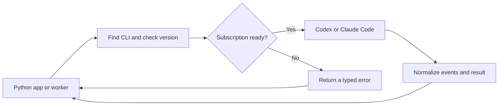

<p align="center">
  
</p>

<h1 align="center">Provider CLI Proxy</h1>

<p align="center">
  Run local AI CLI sessions from Python, with live events and a result your app can use.
</p>

<p align="center">
   <strong>Codex</strong>
  &nbsp;&nbsp;&nbsp;
   <strong>Claude Code</strong>
</p>

<p align="center">
  <a href="#quick-start">Quick start</a> &nbsp;·&nbsp;
  <a href="docs/README.md">Documentation</a> &nbsp;·&nbsp;
  <a href="examples/analysis_job/README.md">Example project</a> &nbsp;·&nbsp;
  <a href="CHANGELOG.md">Changelog</a> &nbsp;·&nbsp;
  <a href="https://github.com/jannikjordan/provider-cli-proxy/issues">Issues</a>
</p>

## What you can do

- **Find a provider.** Discover supported CLI installs through PATH, native installers, Homebrew, WinGet, npm and known macOS desktop bundles.
- **Check readiness.** List located CLIs, their versions, subscription sign-in and available quota windows. A run checks sign-in before sending its prompt.
- **Run or stream.** Pass a prompt or a UTF-8 task file, then wait for the final result or stream updates to a terminal, web app or job worker.
- **Control each run.** Choose the provider, model, effort, working directory and permission profile. Set a deadline or cancel the process tree.
- **Use your existing Python stack.** The library targets Python 3.11+ on macOS, Windows and Linux and has no runtime dependencies.

## How a run works



## Quick start

Install from a local checkout with `python -m pip install .`, or pin a
reviewed commit from this private GitHub repository. Replace `COMMIT_SHA`
with your chosen revision. [Versions and releases](docs/versioning.md)

```sh
python -m pip install "git+https://github.com/jannikjordan/provider-cli-proxy.git@COMMIT_SHA"
```

Install a [supported CLI version](docs/providers.md), sign in through its
own CLI, and run this Python script from a trusted workspace.

```python
import asyncio
from pathlib import Path

from provider_cli_proxy import Client, Prompt, RunRequest

request = RunRequest(
    provider="codex",
    cwd=Path.cwd(),
    prompt=Prompt.text("Explain in one sentence what a job queue does."),
    deadline_seconds=60,
)
result = asyncio.run(Client().run(request))
if result.error:
    raise SystemExit(f"{result.error.code}: {result.error.message}")
print(result.text)
```

Use `Prompt.from_file(Path("task.md"))` to load instructions in your app.
Use `client.start(request)` and `session.events()` to stream the same run.
On Windows, use a native provider `.exe` and the default Proactor event loop.

## Try the example offline

Run these commands from the repository root after installing the package:

```sh
python examples/analysis_job/analyze.py run --provider codex
python examples/analysis_job/analyze.py stream --provider claude
```

Both commands use fixtures by default. The output is based on a synthetic
ticket-count report. The streaming example writes progress to stderr and
the final answer to stdout. [PowerShell setup and live examples](examples/analysis_job/README.md)

## Documentation

| Topic | Guide |
| --- | --- |
| One-shot analysis, chat and queues | [Integration](docs/integration.md) |
| Requests, events, results and errors | [Python API](docs/session-contract.md) |
| CLI installs, sign-in, quotas and permission profiles | [Provider compatibility](docs/providers.md) |
| Offline tests and opt-in smoke checks | [Verification](docs/verification.md) |
| Versions and reporting issues | [Versions and issues](docs/versioning.md) |

The CLI uses its locally configured provider account. Provider-side
`workspace_read` is available on verified macOS combinations. Loading
files through Python works on all three operating systems.
