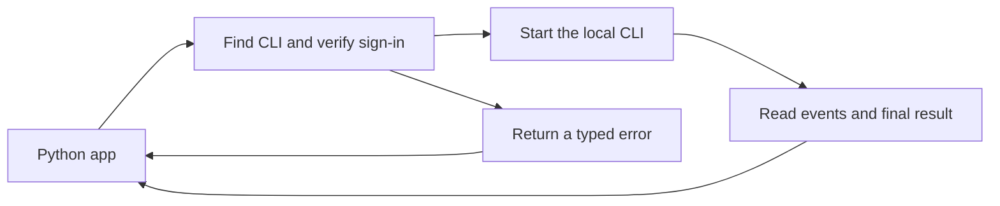

<p align="center">
  
</p>

# Agent Subprocess

Run installed AI CLIs from Python. Send a prompt, follow the session as it
runs, or wait for the final result. The first two providers are
[Codex](https://learn.chatgpt.com/docs/non-interactive-mode) and
[Claude Code](https://code.claude.com/docs/en/headless).

[Quick start](#quick-start) · [Example project](examples/analysis_job/README.md) ·
[Docs](docs/README.md) · [Changelog](CHANGELOG.md) ·
[MIT license](LICENSE)

## What you can do

- Find supported CLIs installed through Homebrew, WinGet, npm, native installers
  and known macOS desktop bundles.
- Check CLI versions, subscription sign-in and available usage windows before
  running a prompt.
- Set the provider, model, effort, workspace and permission profile per run.
  Stop a run yourself or give it a deadline.
- Pass instructions from a string or a UTF-8 file. Consume live events, or use
  one final result with a stable error code on failure.

✅ Python 3.11+ on macOS, Linux and Windows with zero runtime dependencies.
Check the [provider compatibility table](docs/providers.md) for CLI versions
and platform-specific permissions.

## How a run works



## Personal use

⚠️ The subscription-backed integration is for personal, non-commercial
automation. Sign in to the installed CLI with your own account and use its
documented non-interactive mode. Keep customer data out of these runs. The
providers' account terms prohibit sharing your subscription or credentials,
including routing other people's requests through your account.
[Codex CLI docs](https://learn.chatgpt.com/docs/non-interactive-mode) ·
[Claude Code CLI docs](https://code.claude.com/docs/en/headless) ·
[OpenAI terms](https://openai.com/policies/eu-terms-of-use/) ·
[Anthropic terms](https://www.anthropic.com/legal/consumer-terms)

The [MIT license](LICENSE) covers the project code and documentation.
Each provider's terms govern access to its service.

## Quick start

Activate a Python 3.11+ virtual environment. Check out `dev` to try the
renamed package today.

```sh
git clone --branch dev https://github.com/jannikjordan/provider-cli-proxy.git agent-subprocess
cd agent-subprocess
python -m pip install .
```

Install a [supported CLI version](docs/providers.md) and sign in through the
CLI. Save the script below as `hello_agent.py` and run
`python hello_agent.py` from a trusted directory.

```python
import asyncio
from pathlib import Path

from agent_subprocess import Client, Prompt, RunRequest

request = RunRequest(
    provider="codex",
    cwd=Path.cwd(),
    prompt=Prompt.text("Explain in one sentence what a job queue does."),
    deadline_seconds=60,
)

result = asyncio.run(Client().run(request))
if result.error:
    raise SystemExit(f"{result.error.code}: {result.error.message}")
print(result.text)
```

💡 Use `Prompt.from_file("task.md")` to load instructions from a trusted
file in Python. The [integration guide](docs/integration.md#stream-an-assistant-response)
shows how to stream the same run. On Windows, use a native provider `.exe`
and the default Proactor event loop.

## Try the example offline

Run this from the repository root after installing the package.

```sh
python examples/analysis_job/minimal.py
```

The script loads a synthetic ticket report and prints the answer returned
by a fake CLI. It needs no provider account. The
[example project](examples/analysis_job/README.md) also shows streaming with
both providers, PowerShell setup and how to opt into a live run.

## Documentation

- [Integration guide](docs/integration.md) for file-backed jobs, streaming and queues.
- [Python API](docs/session-contract.md) for request fields, events and errors.
- [Provider guide](docs/providers.md) for discovery, permissions and compatibility.
- [Versions and issues](docs/versioning.md) for release pins and how to report bugs.
